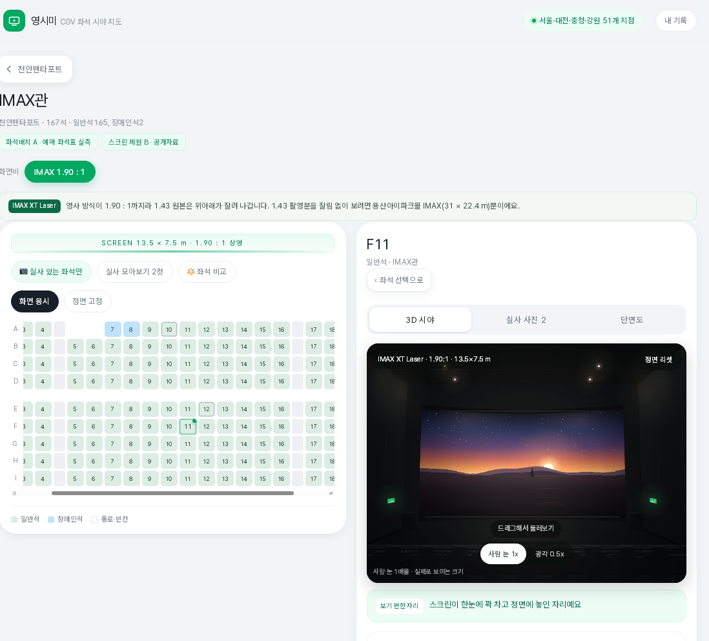

# 영시미 — 서울·대전·충청 CGV 49개 지점 좌석 시야 지도

CGV **서울 29개 · 대전·충청 20개 지점**의 실제 예매 좌석표를 그대로 옮겨, 좌석을 하나 고르면 그 자리에서 화면이 어떻게 보이는지(시야각·거리·고개 각도·가림·단차) 미리 보여주는 웹 앱입니다.

- **바로 보기**: https://cfz566stzm-png.github.io/-cgv-chungnam-seat-view/
- 2단계 확장 기록: [서울-대전충청-cgv-확장-조사결과.md](서울-대전충청-cgv-확장-조사결과.md)
- 1단계 충남 조사: [충남권-cgv-조사결과.md](충남권-cgv-조사결과.md)
- 스크린샷: [preview-seat-view.png](preview-seat-view.png) · [preview-seat-profile.png](preview-seat-profile.png)



## 2026-11-17 2단계 확장

- **지역 탭**: 전체 49 / 서울 29 / 대전·충청 20 + 지점명 검색.
- 서울 지점은 주소·특별관(IMAX·4DX·SCREENX·돌비애트모스·씨네드쉐프) 정보를 함께 표기.
- 새로 확보한 좌석표: **용산아이파크몰 IMAX(624석, 국내 최대급)**, 대전 IMAX(364)·3관(344)·4DX(108), 대전터미널 IMAX(225)·SCREENX(230), 세종 6관 SCREENX(172), 청주(서문) IMAX(258).
- 아직 상영관 목록/좌석표가 없는 지점은 카드에 "상영관 정보·좌석표 준비 중"으로 표시합니다(추측으로 채우지 않음).

## 무엇을 하는 사이트인가

1. **지점 둘러보기** — 천안터미널·천안펜타포트·천안·아산·서산·당진·논산·홍성 8개 지점, 56개 상영관.
2. **상영관 선택** — 상영관별 좌석수를 보고 실제 좌석 배치도(좌석 1석 단위 좌표)를 엽니다.
3. **좌석 선택** — 좌석을 누르면
   - 1인칭 시야 캔버스(화면 응시 / 정면 고정 모드),
   - 상영관 단면도와 고개 각도,
   - 화면까지의 거리, 가로·세로 시야각, 앞사람에 의한 가림, 단차,
   - 좌석 유형(SWEETBOX·릴렉스시트·리클라이너·카바나·빈백 등)
   를 계산해 보여줍니다.
4. **좌석 후기** — 자리별 한줄 후기를 남기고 "내 기록"에서 모아 볼 수 있습니다(현재 브라우저 로컬 저장).
5. **좌석 카드 복사** — 고른 좌석의 시야 요약을 텍스트로 복사해 친구에게 보낼 수 있습니다.

모바일에서는 좌석을 고르면 바텀시트로 열리고, 데스크톱은 2단 레이아웃(900px 기준)입니다.

## 수집 결과 요약

- 조사 기준일: 2026-11-17 (화), 조사 시각 00:30~04:25
- 방법: CGV 홈페이지 극장별 예매 → 회차 클릭 → **좌석 선택 화면의 좌석표 DOM** 좌표(38px 격자)·좌석번호·좌석유형 판독
- 충남권 CGV **8개 지점 · 56개 상영관**(좌석수 확인) 중 **29개 상영관 좌석표 전수 확보**, 총 6,846석 중 **4,144석**을 1석 단위로 좌표화
- 확보율: 상영관 기준 29/56, 좌석 기준 4,144/6,846 (60.5%)

| 지점 | 상영관 | 좌석표 확보 | 총 좌석 | 특별관 |
|---|---|---|---|---|
| CGV 천안터미널 | 9 | 9 | 1,459 | IMAX, 4DX, 씨네앤포레, PRIVATE BOX, Laser |
| CGV 천안펜타포트 | 10 | 9 | 1,139 | IMAX, SCREENX, 4DX, 아트하우스, Laser |
| CGV 천안 | 7 | 3 | 919 | — |
| CGV 아산 | 4 | 1 | 288 | 리클라이너, Laser |
| CGV 서산 | 8 | 0 | 820 | — |
| CGV 당진 | 7 | 7 | 1,075 | — |
| CGV 논산 | 5 | 0 | 500 | 리클라이너, Laser |
| CGV 홍성 | 6 | 0 | 646 | 리클라이너, Laser |

미확보 27개 관은 조사 당일(11/17) 회차가 편성되지 않아 좌석 선택 화면에 들어갈 수 없었던 관입니다. 좌석수는 확인했지만 배치도는 **추정으로 채우지 않았습니다**. 주말 회차가 열리면 같은 방법으로 채울 수 있습니다.

## 데이터 신뢰도

| 항목 | 등급 | 설명 |
|---|---|---|
| 좌석 배치도 | **A (실측)** | CGV 예매 좌석표를 그대로 이전 |
| 스크린 크기·열 간격·단차 | **C (추정)** | 공식 도면이 없어 객석 규모·유형 대푯값으로 추정 (천안펜타포트 IMAX만 공개 자료와 일치해 B). 단차는 아래 '좌석 단차 근거'의 공개 설계 기준 범위 안에서 유형별 대푯값을 씁니다. |

그래서 **같은 관 안에서 어느 자리가 나은가**는 믿을 수 있지만, 절대 시야각은 ±5° 정도 오차가 있을 수 있습니다. 사이트의 좌석 카드에도 이 등급을 표시합니다.

## 저장소 구성

| 파일 | 설명 |
|---|---|
| `index.html` | 사이트 전체(단일 파일, 데이터 내장). 외부 의존은 Pretendard 웹폰트 CDN뿐 |
| `충남권-cgv-조사결과.md` | 지점·상영관별 전수조사 표와 검증 결과 원문 |
| `preview-seat-view.png` | 좌석 선택 후 1인칭 시야 화면 |
| `preview-seat-profile.png` | 단면도·고개 각도 화면 |

데이터 구조:

```json
{ "theater": "당진", "hall": "1관", "total": 215,
  "rows": ["A", "B"],
  "seats": [{ "label": "A1", "x": 2, "y": 0, "type": "n" }] }
```

`x`가 빈 칸은 통로·계단, `type`은 `n` 일반석 · `p` 장애인석 · `s` SWEETBOX · `r` 릴렉스시트 · `c` 카바나 · `b` 빈백 · `x` 판매중지입니다.

## 배포

GitHub Pages, `main` 브랜치 루트(`/`)를 그대로 서빙합니다. 빌드 과정은 없습니다.

## 고지

CGV·CJ 4DPLEX와 제휴하지 않은 비공식 서비스입니다. 상표는 설명 목적으로만 사용했고, 좌석표는 공개 예매 화면에서 확인한 정보입니다.

## 2026-11-17 IMAX 화면비·관별 시야 보정

- **1.43:1 상영은 용산아이파크몰 IMAX(GT Laser, 31×22.4m) 한 곳뿐**입니다. 나머지 IMAX관은 1.90:1 상영이며, 천호(24.7×18.7m)는 1.43 규격으로 지은 스크린이지만 CoLa 영사기라 1.90까지만 켜집니다(위아래 약 2.8m 여백).
- 9개 IMAX관 스크린 제원(가로×세로·영사 방식·앞열 거리·단차)을 공개자료와 좌석별 시야 후기·실사 계측으로 보정했습니다. 예: 용산 31.0×22.4m(앞열 9.5m·단차 0.45m), 천호 24.7×18.7m(단차 0.55m), 왕십리 22.0×13.3m, 영등포 18.0×9.7m(추정), 압구정 15.5×8.5m, 대전 16.0×8.5m, 대전터미널 13.5×7.5m, 청주 18.4×9.9m, 천안터미널 15.6×8.4m, 천안펜타포트 13.5×7.5m.
- 일반관은 화면 높이에 따른 앞열 거리 규칙으로 다시 계산해, 소형 리클라이너관(예: 천안터미널 3관)과 대형 일반관, IMAX관의 3D 시야가 실제로 다르게 보입니다.
- 좌석판은 세로 통로(16px)·가로 통로(펜타포트 D↔E)·좌석 번호를 표시하고, 넓은 관은 좌석판 안에서만 가로 스크롤됩니다.

## 2026-11-17 3D 시야 뷰어 리얼리티 작업 + 좌석 단차 근거

- **3D 화면을 실제 상영관 사진(용산·천안펜타포트 실사)에 맞춰 다시 그렸습니다.** 밝은 회색 박스 대신, 거의 검정에 가까운 차콜 음향패널 벽(패널 이음매만 희미하게), 천장 다운라이트와 벽·스크린 상단 모서리에 떨어지는 따뜻한 빛 번짐, 좌우 비상구 초록 표시등, 스크린 양옆 스피커, 앞열 앞 크롬 난간과 통로 손잡이, 검은 좌석 실루엣(앞열만 얇게 빛을 받음)을 그립니다. 스크린 그림은 영사광을 옅게만 얹어 선명하게 유지합니다.
- **좌석 단차(관 유형별 기준표)**: 일반관 0.25m · 아트하우스 0.24m · SCREENX 0.28m · 4DX 0.30m · 리클라이너 0.40m · 씨네앤포레 0.20m · IMAX 0.34~0.55m(지점별 제원 우선).
- **근거**: 「극장 시설 설계 기준」(한국영사예술인협회 기술교서)의 *앞뒤 슬로프 15~30cm·시선 간격 120mm*, UNIC 영화관 설계 지침의 *시선 여유 150~200mm, 계단 1단 최대 200mm 내외(한 행 2~3단)*, CGV 리클라이너 시공사례(Usit, 단 최대 460mm). **법정 기준(영화법 시행규칙 별표1)은 좌석 단차를 규정하지 않습니다.**
- 지점별 도면이 없으므로 화면에서는 **'좌석 단차 = 관 유형 기준값(공개자료)'** 과 **'이 관 적용값(추정)'** 을 나눠 표기하고, 실사로 계측한 관(천안펜타포트 IMAX F11)만 '실측'으로 올립니다.
- 관·지점을 옮기면 좌석 비교 목록·비교 모드·비교 창이 어떤 경로(해시·뒤로가기·좌석판·지점 카드)로 이동해도 초기화됩니다.
